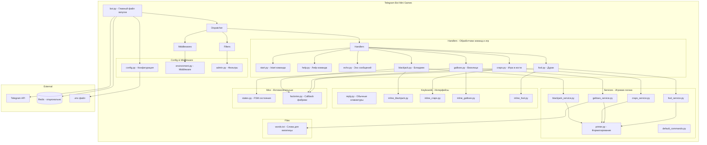

# Telegram Bot с Мини-Играми 🎮

Telegram-бот, предоставляющий набор классических игр: Блэкджек, Craps (покер в кости), Виселица и Дурак. Построен на фреймворке aiogram с поддержкой асинхронного программирования и машины состояний (FSM).

## 📁 Структура проекта

```
mini_games/
├── bot.py                          # Главный файл запуска бота
├── main.py                         # Автономная версия игры Craps (консоль)
├── requirements.txt                # Python зависимости
├── Dockerfile                      # Конфигурация Docker
├── docker-compose.yml              # Настройки Docker Compose
└── tgbot/                          # Основной модуль бота
    ├── __init__.py
    ├── config.py                   # Конфигурация и настройки
    ├── files/                      # Файлы данных
    │   ├── __init__.py
    │   └── words.txt              # Словарь для игры "Виселица"
    ├── filters/                    # Фильтры для обработки сообщений
    │   ├── __init__.py
    │   └── admin.py               # Фильтр администраторов
    ├── handlers/                   # Обработчики команд и игр
    │   ├── __init__.py
    │   ├── start.py               # Команда /start
    │   ├── help.py                # Команда /help
    │   ├── echo.py                # Эхо-обработчик
    │   ├── blackjack.py           # Игра Блэкджек
    │   ├── craps.py               # Игра Craps (кости)
    │   ├── gallows.py             # Игра Виселица
    │   └── fool.py                # Игра Дурак
    ├── keyboards/                  # Клавиатуры и интерфейсы
    │   ├── __init__.py
    │   ├── reply.py               # Обычные клавиатуры
    │   ├── inline_blackjack.py    # Inline-клавиатуры для Блэкджека
    │   ├── inline_craps.py        # Inline-клавиатуры для Craps
    │   ├── inline_gallows.py      # Inline-клавиатуры для Виселицы
    │   └── inline_fool.py         # Inline-клавиатуры для Дурака
    ├── middlewares/                # Middleware для обработки запросов
    │   ├── __init__.py
    │   └── environment.py         # Middleware окружения
    ├── misc/                       # Вспомогательные модули
    │   ├── __init__.py
    │   ├── factories.py           # Фабрики callback данных
    │   └── states.py              # Состояния FSM
    ├── models/                     # Модели данных (пустая папка)
    │   └── __init__.py
    └── services/                   # Бизнес-логика игр
        ├── __init__.py
        ├── blackjack_service.py   # Логика Блэкджека
        ├── craps_service.py       # Логика Craps
        ├── gallows_service.py     # Логика Виселицы
        ├── fool_service.py        # Логика Дурака
        ├── printer.py             # Форматирование и вывод
        └── default_commands.py    # Команды по умолчанию
```

## 📄 Описание файлов

### Корневые файлы

#### `bot.py`
**Назначение**: Главная точка входа в приложение Telegram-бота.
**Ключевые функции**:
- `main()` - асинхронная функция запуска бота
- `register_all_middlewares()` - регистрация middleware
- `register_all_filters()` - регистрация фильтров
- `register_all_handlers()` - регистрация обработчиков команд
**Связи**: Импортирует все обработчики, middleware и сервисы
**Логика**: Инициализирует бота, настраивает логирование, регистрирует компоненты и запускает polling

#### `main.py`
**Назначение**: Автономная консольная версия игры Craps (покер в кости).
**Ключевые классы**:
- `Player` - игрок с методами броска и перебрасывания костей
- `Dice` - отдельная кость
- `DiceSet` - набор из 5 костей
- `Game` - основная логика игры
**Связи**: Независимый модуль, не связан с Telegram-ботом
**Логика**: Реализует полноценную игру в кости между человеком и компьютером

#### `requirements.txt`
**Назначение**: Список зависимостей Python проекта.
**Основные библиотеки**: aiogram (2.25.1), aiohttp, environs, python-dotenv

### Конфигурация

#### `tgbot/config.py`
**Назначение**: Управление конфигурацией бота.
**Ключевые классы**:
- `TgBot` - настройки бота (токен, админы, Redis)
- `Config` - общая конфигурация
- `load_config()` - загрузка из переменных окружения
**Связи**: Используется в bot.py и middleware
**Логика**: Загружает настройки из .env файла с помощью environs

### Обработчики (Handlers)

#### `tgbot/handlers/start.py`
**Назначение**: Обработка команды `/start`.
**Функции**: `user_start()` - приветствие и список доступных команд
**Связи**: Использует `default_commands.py`
**Логика**: Завершает текущее состояние FSM и показывает список команд

#### `tgbot/handlers/help.py`
**Назначение**: Обработка команды `/help`.
**Функции**: `print_help()` - вывод справки
**Связи**: Использует `default_commands.py`
**Логика**: Аналогично start, но без завершения состояния

#### `tgbot/handlers/echo.py`
**Назначение**: Эхо-обработчик для отладки и fallback.
**Функции**:
- `bot_echo()` - эхо без состояния
- `bot_echo_all()` - эхо с информацией о состоянии
**Связи**: Не зависит от других модулей
**Логика**: Отправляет обратно полученное сообщение с дополнительной информацией

#### `tgbot/handlers/blackjack.py`
**Назначение**: Обработка игры Блэкджек (21 очко).
**Ключевые функции**:
- `blackjack()` - запуск игры
- `start_blackjack()` - начало новой игры
- `player_takes_card()` - игрок берёт карту
- `player_enough_card()` - игрок остается с текущими картами
- `bot_take_card()` - ход бота
**Связи**:
- `blackjack_service.py` - игровая логика
- `inline_blackjack.py` - клавиатуры
- `printer.py` - форматирование
**Логика**: Реализует пошаговую игру в блэкджек до 5 побед с поддержкой FSM

#### `tgbot/handlers/craps.py`
**Назначение**: Обработка игры Craps (покер в кости).
**Ключевые функции**:
- `craps()` - запуск игры
- `players_roll()` - бросок игрока
- `bots_roll()` - бросок бота
- `get_dice_for_reroll()` - выбор костей для перебрасывания
- `reroll_done()` - завершение перебрасывания
**Связи**:
- `craps_service.py` - игровая логика
- `inline_craps.py` - клавиатуры
- `factories.py` - callback фабрики
**Логика**: Покер в кости с возможностью перебрасывания выбранных костей

#### `tgbot/handlers/gallows.py`
**Назначение**: Обработка игры Виселица.
**Ключевые функции**:
- `gallows()` - запуск игры
- `start_gallows()` - начало игры и выбор слова
- `get_letter()` - обработка введённой буквы
**Связи**:
- `gallows_service.py` - игровая логика
- `states.py` - FSM состояние ожидания буквы
- `files/words.txt` - словарь слов
**Логика**: Классическая виселица с проверкой букв и подсчётом ошибок

#### `tgbot/handlers/fool.py`
**Назначение**: Обработка игры Дурак.
**Ключевые функции**:
- `fool()` - запуск игры
- `start_fool()` - инициализация колоды и раздача карт
- `player_put_card()` - игрок кладёт карту
- `player_covers()` - игрок кроет карту
- `player_takes()` - игрок берёт карты
**Связи**:
- `fool_service.py` - сложная игровая логика
- `inline_fool.py` - клавиатуры
- `factories.py` - callback фабрики
**Логика**: Полная реализация классического дурака с козырями и покрытием

### Сервисы (Services)

#### `tgbot/services/default_commands.py`
**Назначение**: Управление командами бота.
**Функции**:
- `set_default_commands()` - установка команд в Telegram
- `get_default_commands()` - получение списка команд для вывода
**Связи**: Используется в handlers и bot.py
**Логика**: Централизованное управление списком доступных команд

#### `tgbot/services/blackjack_service.py`
**Назначение**: Бизнес-логика игры Блэкджек.
**Ключевые функции**:
- `create_deck()` - создание колоды карт
- `pick_card()` - взятие случайной карты
- `get_cards_points()` - подсчёт очков с учётом тузов
- `play_blackjack_round()` - логика раунда
- `check_fairplay()` - проверка на читерство
**Связи**: Использует printer.py для форматирования карт
**Логика**: Подсчёт очков, логика ИИ бота, определение победителя

#### `tgbot/services/craps_service.py`
**Назначение**: Бизнес-логика игры Craps.
**Ключевые функции**:
- `roll_dice()` - бросок костей
- `check_combination()` - определение покерной комбинации
- `should_bot_reroll()` - ИИ бота для перебрасывания
- `choose_dices_for_bots_reroll()` - выбор костей для перебрасывания ботом
**Связи**: Использует collections.Counter для анализа комбинаций
**Логика**: Покерные комбинации от пары до покера, ИИ стратегия бота

#### `tgbot/services/gallows_service.py`
**Назначение**: Бизнес-логика игры Виселица.
**Ключевые функции**:
- `choose_word()` - случайный выбор слова из файла
- `check_letter()` - проверка буквы в слове
- `is_word_guessed()` - проверка полного отгадывания
- `check_gallows_game_status()` - проверка окончания игры
**Связи**: Читает words.txt, использует printer.py для ASCII-арт
**Логика**: Простая логика с подсчётом ошибок (максимум 8)

#### `tgbot/services/fool_service.py`
**Назначение**: Сложная бизнес-логика игры Дурак.
**Ключевые функции**:
- `create_deck()` - создание русской колоды (36 карт)
- `check_who_first()` - определение первого хода по младшему козырю
- `bot_turn()` - ИИ бота для подкидывания/покрытия
- `place_card_on_desk()` - размещение карт на столе
- `check_more_cards()` - проверка возможности подкинуть
**Связи**: Сложные связи с printer.py и inline_fool.py
**Логика**: Полные правила дурака, ИИ стратегия, управление козырями

#### `tgbot/services/printer.py`
**Назначение**: Форматирование и вывод игровой информации.
**Константы**:
- `DICES` - эмодзи костей
- `GALLOWS` - ASCII-арт виселицы
- `HAPPY_EMOTIONS`/`UNHAPPY_EMOTIONS` - фразы бота
- `SUITS`/`VALUES` - карточные масти и значения
**Функции**: Форматирование карт, костей, правил игр
**Связи**: Используется всеми игровыми сервисами
**Логика**: Централизованное форматирование с эмодзи и ASCII-артом

### Клавиатуры (Keyboards)

#### `tgbot/keyboards/reply.py`
**Назначение**: Обычные клавиатуры для каждой игры.
**Клавиатуры**:
- `craps_game_actions` - сдаться/правила для Craps
- `gallows_game_actions` - сдаться/правила для Виселицы
- `blackjack_game_actions` - сдаться/правила для Блэкджека
- `fool_game_actions` - сдаться для Дурака
**Связи**: Используются в соответствующих handlers
**Логика**: Единообразные кнопки управления игрой

#### `tgbot/keyboards/inline_*.py`
**Назначение**: Inline-клавиатуры для каждой игры с callback данными.
**Особенности**: Динамическое создание кнопок в зависимости от состояния игры
**Связи**: Используют factories.py для callback данных
**Логика**: Интерактивные кнопки для игровых действий

### Вспомогательные модули

#### `tgbot/misc/states.py`
**Назначение**: Определение состояний для машины состояний (FSM).
**Группы состояний**:
- `Games` - общие игровые состояния
- `Players` - состояния игроков
- `GallowsGame` - специальные состояния для Виселицы
**Связи**: Используется в handlers для управления контекстом
**Логика**: Обеспечивает persistence данных между сообщениями

#### `tgbot/misc/factories.py`
**Назначение**: Фабрики для создания callback данных.
**Фабрики**:
- `for_reroll` - перебрасывание костей в Craps
- `for_fool_player_turn` - ходы игрока в Дураке
- `for_fool_player_cover` - покрытие карт в Дураке
**Связи**: Используются в inline клавиатурах и handlers
**Логика**: Типизированная передача данных через callback

#### `tgbot/middlewares/environment.py`
**Назначение**: Middleware для передачи конфигурации в handlers.
**Связи**: Используется в bot.py, доступна в handlers
**Логика**: Автоматическое внедрение конфигурации в обработчики

#### `tgbot/filters/admin.py`
**Назначение**: Фильтр для проверки прав администратора.
**Связи**: Регистрируется в bot.py
**Логика**: Проверка ID пользователя со списком администраторов

## 🏗️ Архитектура проекта

### Общая структура
Проект следует модульной архитектуре с разделением ответственности:
- **Handlers** - обработка пользовательского ввода
- **Services** - бизнес-логика игр
- **Keyboards** - пользовательский интерфейс
- **Misc** - вспомогательные компоненты

### Потоки данных
1. Пользователь отправляет команду/сообщение
2. Dispatcher направляет в соответствующий Handler
3. Handler вызывает Service для обработки логики
4. Service обновляет состояние через FSM
5. Handler отправляет ответ с Keyboard
6. Цикл повторяется до завершения игры

### Архитектурная схема



## 📚 Библиотеки и фреймворки

### Основные зависимости

| Библиотека | Версия | Назначение | Использование |
|------------|--------|------------|---------------|
| **aiogram** | 2.25.1 | Telegram Bot Framework | Основной фреймворк для создания бота |
| **aiohttp** | 3.8.5 | HTTP клиент/сервер | Используется aiogram для HTTP запросов |
| **environs** | 9.5.0 | Управление переменными окружения | Загрузка конфигурации из .env |
| **python-dotenv** | 1.0.0 | Поддержка .env файлов | Работа с переменными окружения |

### Вспомогательные библиотеки

| Библиотека | Назначение | Где используется |
|------------|------------|------------------|
| **asyncio** | Асинхронное программирование | Все асинхронные функции |
| **random** | Генерация случайных чисел | Игровая логика (карты, кости, слова) |
| **collections.Counter** | Подсчёт элементов | Анализ покерных комбинаций в Craps |
| **typing** | Типизация | Аннотации типов во всех модулях |

## 🚀 Точка входа и запуск

### Основной запуск (Telegram Bot)
1. **Файл запуска**: `bot.py`
2. **Точка входа**: `if __name__ == '__main__': asyncio.run(main())`
3. **Последовательность выполнения**:
   ```python
   main() → logging.basicConfig() → load_config() →
   Bot() → Dispatcher() → register_middlewares() →
   register_filters() → register_handlers() →
   set_default_commands() → dp.start_polling()
   ```

### Альтернативный запуск (консольная игра)
1. **Файл запуска**: `main.py`
2. **Точка входа**: `if __name__ == "__main__":`
3. **Логика**: Автономная игра Craps в консоли

### Запуск через Docker
```bash
# Сборка и запуск
docker-compose up --build

# Переменные окружения в .env:
BOT_TOKEN=your_bot_token
ADMINS=123456789,987654321
USE_REDIS=false
BOT_CONTAINER_NAME=mini_games_bot
```

### Требования к окружению
- Python 3.10+
- Переменные окружения в `.env` файле:
  - `BOT_TOKEN` - токен Telegram бота
  - `ADMINS` - список ID администраторов
  - `USE_REDIS` - использование Redis для хранения состояний

## 🔧 Архитектурные особенности

### 1. Модульная архитектура
**Решение**: Разделение на handlers, services, keyboards
**Причина**: Обеспечивает легкость тестирования и масштабирования

### 2. Машина состояний (FSM)
**Решение**: Использование aiogram FSM для хранения игрового контекста
**Причина**: Telegram API stateless, необходимо сохранять состояние между сообщениями

### 3. Callback фабрики
**Решение**: Типизированные callback данные через CallbackData
**Причина**: Безопасная передача данных в inline кнопках

### 4. Асинхронная архитектура
**Решение**: Все функции асинхронные (async/await)
**Причина**: Высокая производительность при множественных запросах

### 5. Централизованное форматирование
**Решение**: Отдельный модуль `printer.py` для всего вывода
**Причина**: Единообразие интерфейса и легкость изменения

### 6. Конфигурация через переменные окружения
**Решение**: Использование environs для загрузки настроек
**Причина**: Безопасность и гибкость развертывания

### 7. Двойная реализация игры
**Решение**: Craps реализован и как Telegram игра, и как консольная
**Причина**: Демонстрация различных подходов к пользовательскому интерфейсу

## 🎯 Заключение

Проект представляет собой хорошо структурированного Telegram-бота с 4 полноценными играми. Архитектура обеспечивает:

- **Масштабируемость**: Легко добавить новые игры
- **Поддерживаемость**: Четкое разделение ответственности
- **Тестируемость**: Модульная структура
- **Производительность**: Асинхронная обработка
- **Безопасность**: Валидация данных и проверка прав

---

Автор: legenda  
Telegram: [@LEGENDA_SD](https://t.me/LEGENDA_SD)
